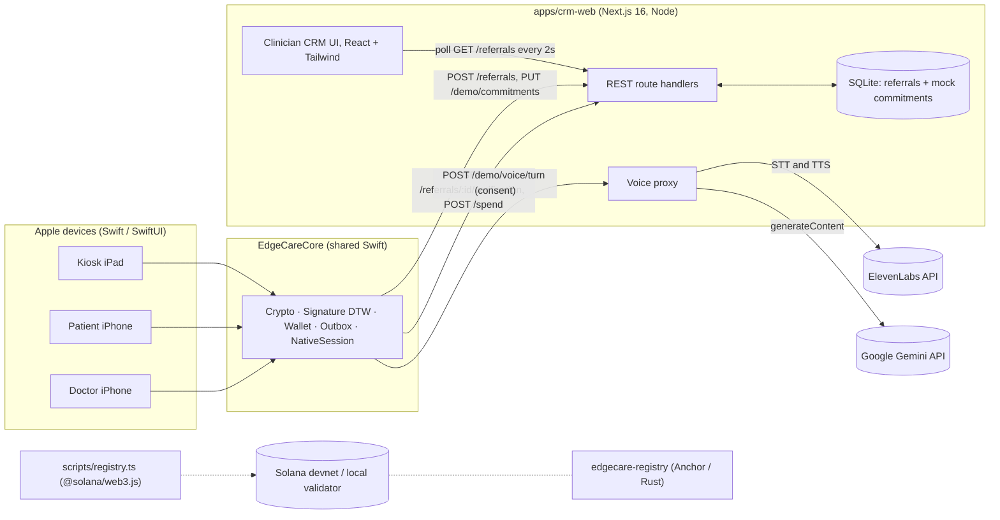

# Edge-Care: Tech Stack and System Map

This document covers every part of the Edge-Care monorepo: how the repository is laid out, what each subsystem does, the language and framework behind each layer, how the parts talk to each other, and which external services are involved (servers, ElevenLabs, Google/Gemini, Solana). A TL;DR is at the end.

Related docs: [README.md](README.md) (how to run it), [API.md](API.md) (wire contract), [docs/architecture.md](docs/architecture.md), [docs/decisions.md](docs/decisions.md), [docs/voice-intake.md](docs/voice-intake.md), [docs/verification.md](docs/verification.md).

---

## 1. What the product is

Edge-Care is a Junction 2026 hackathon build for the AstraZeneca Finland cancer-care challenge. It offers anonymous, multilingual, offline-first cancer-care intake for people who avoid the health system because of language barriers, fear or a lack of documents.

- A patient uses a **kiosk iPad** or **their own iPhone** to describe a concern, by structured form or voice conversation, in English, Finnish, Somali, Arabic or Russian.
- If a referral is warranted, the patient **draws a signature** and **picks a 4-digit code**. Those two things are the only "identity": there is no account, no name and no recovery.
- The app builds a **cryptographic commitment** (a SHA-256 hash) from the signature template, code, referral ID and a salt, encrypts the private parts, and registers the commitment as **single-use**.
- A clinician browses anonymous referrals in a **web CRM**. At the appointment, the **doctor iPhone app** has the patient redraw the signature and enter the code, checks both against the commitment, and **spends** it so it cannot be reused.

Two rules shape most design choices: **anonymous by default** and **offline-first**.

---

## 2. Repository layout

The repo holds four apps, two shared packages, one Solana program, a video project, scripts and docs. It is polyglot: **TypeScript**, **Swift**, **Rust** and **Python**.

```
junction-twenty-six/
├── apps/
│   ├── crm-web/             # System 2: Next.js 16 clinician CRM + the REST backend + SQLite
│   ├── kiosk-ios/           # System 1: SwiftUI iPad kiosk (thin entry point)
│   ├── patient-ios/         # System 4: SwiftUI iPhone patient app (thin entry point)
│   └── doctor-ios/          # System 3: SwiftUI iPhone doctor verification app (thin entry point)
├── packages/
│   ├── edgecare-core/       # Swift Package: EdgeCareCore (logic) + EdgeCareUI (shared SwiftUI screens)
│   └── shared-types/        # TypeScript: Zod schemas, types, CRM projection, fixtures, JSON Schema
├── programs/
│   └── edgecare-registry/   # Rust / Anchor 0.32.1 Solana program (commitment registry)
├── demo/
│   └── remotion/            # Remotion 4 (React) 90-second pitch video composition
├── scripts/                 # Fixture/schema generation, Solana devnet CLI, Apple demo launcher, voiceover
│   └── tests/               # Registry encoding tests (TS) + launcher tests (Python)
├── tests/
│   └── clinical-flow.spec.ts  # Playwright end-to-end browser/API test
├── docs/                    # Brief, architecture, decisions, voice, verification, design references
├── API.md                   # Shared integration contract v1
├── package.json             # pnpm root scripts (orchestrates everything)
├── pnpm-workspace.yaml      # JS workspaces: crm-web, shared-types, demo/remotion
├── project.yml              # XcodeGen spec that generates EdgeCare.xcodeproj (3 iOS targets)
├── Cargo.toml / Anchor.toml # Rust workspace + Anchor toolchain config
├── playwright.config.ts     # Browser test config
├── tsconfig.base.json       # Shared strict TS config
└── .github/workflows/ci.yml # CI: web (Ubuntu), apple (macOS 15), registry (Rust)
```

### 2.1 The three build systems

Three independent toolchains sit side by side. The root `package.json` wraps all of them as pnpm scripts:

| Toolchain | Scope | Config | Key commands |
| --- | --- | --- | --- |
| **pnpm 9.15.9 workspaces** (Node ≥ 22.11) | `apps/crm-web`, `packages/shared-types`, `demo/remotion`, root scripts | `pnpm-workspace.yaml`, `package.json`, `tsconfig.base.json` | `pnpm dev`, `pnpm build`, `pnpm check`, `pnpm test`, `pnpm test:browser`, `pnpm schema`, `pnpm registry`, `pnpm demo:studio` |
| **Swift Package Manager + XcodeGen** (Swift 6, iOS 17+) | `packages/edgecare-core` and the three `apps/*-ios` targets | `packages/edgecare-core/Package.swift`, `project.yml` | `pnpm ios:generate` (`xcodegen generate`), `pnpm test:swift` (`swift test`), `pnpm ios:demo` |
| **Cargo + Anchor 0.32.1** (Rust 2021) | `programs/edgecare-registry` | `Cargo.toml`, `Anchor.toml` | `cargo test -p edgecare-registry`, `anchor build` |

The Xcode project is **not committed**. `project.yml` is the source of truth, and XcodeGen generates `EdgeCare.xcodeproj` from it with three app targets (`EdgeCareKiosk`, `EdgeCareDoctor`, `EdgeCarePatient`). Each target depends on both products of the local `EdgeCareCore` Swift package.

### 2.2 How code is shared

The system enforces "implement the protocol once" with **two shared packages, one per language**. They agree through **shared JSON fixtures and a JSON Schema**:

- `packages/edgecare-core` (Swift) is used by all three iOS apps.
- `packages/shared-types` (TypeScript) is used by the CRM/backend and the scripts.
- `scripts/generate-fixtures.mjs` produces deterministic synthetic referrals, encrypted with real HKDF/AES-GCM and the synthetic code `1234`. The same `referrals.json` ships in both `packages/shared-types/fixtures/` and `packages/edgecare-core/Sources/EdgeCareCore/Resources/`. Tests in both languages decode it, which keeps the wire format in sync.
- `scripts/generate-schema.ts` emits `packages/shared-types/schema/referral.schema.json` from the Zod schema. CI regenerates it and fails if it differs from the committed copy.

Apps never call one another. Every app talks only to **the one REST backend** and **the commitment registry** (see §4).

---

## 3. Subsystems in detail

### 3.1 `apps/crm-web`: Doctor CRM and the shared backend (System 2)

This app serves two roles: the **clinician web UI** and the **only server in the system**. The REST API that every app calls is a set of Next.js route handlers inside this app.

**Languages and frameworks**

| Layer | Technology |
| --- | --- |
| Language | TypeScript (strict, `noUncheckedIndexedAccess`) |
| Framework | **Next.js 16.4.6** (App Router; route handlers for the REST API) |
| UI | **React 19.3.1** client components |
| Styling | **Tailwind CSS 4.1.18** via `@tailwindcss/postcss` (`@import "tailwindcss"` in `globals.css`) |
| Database | **SQLite** via **better-sqlite3 11.10.0** (synchronous, WAL mode, `busy_timeout` 5 s). Marked `serverExternalPackages` in `next.config.ts` |
| Validation | **Zod 4** schemas imported from `@edgecare/shared-types` (transpiled via `transpilePackages`) |
| Crypto/auth | Node `crypto`: HMAC-SHA256 signed session cookies, `timingSafeEqual` token comparison |
| Tests | Node's built-in test runner via `tsx --test` (`apps/crm-web/tests/*.test.ts`) and Playwright (`tests/clinical-flow.spec.ts`) |

**Source structure**

```
apps/crm-web/src/
├── app/                          # Next.js App Router
│   ├── layout.tsx, page.tsx      # Shell; page shows demo-login or the dashboard
│   ├── globals.css               # Tailwind entry + brand tokens
│   ├── health/route.ts           # GET /health
│   ├── referrals/route.ts        # GET (list) / POST (enroll) /referrals
│   ├── referrals/[id]/route.ts               # GET allowlisted detail
│   ├── referrals/[id]/verification/route.ts  # GET encrypted envelope (doctor device only)
│   └── demo/
│       ├── session/route.ts                  # POST/DELETE browser demo session
│       ├── commitments/[id]/route.ts         # GET/PUT mock registry commitment
│       ├── commitments/[id]/spend/route.ts   # POST single-use spend
│       ├── voice/turn/route.ts               # POST voice conversation turn (ElevenLabs + Gemini)
│       └── profile/normalize/route.ts        # POST text → English clinical profile (Gemini only)
├── components/
│   ├── demo-login.tsx            # "Enter clinician demo" button (+ optional bearer token)
│   └── referral-dashboard.tsx    # Filters, sort, detail, 2-second polling, stale-data warning
└── server/
    ├── backend.ts                # Singleton DemoRepository; seeds 3 synthetic referrals
    ├── repository.ts             # SQLite implementation of ReferralRepository + ChainClient
    ├── auth.ts                   # Session cookie, bearer roles, loopback + same-origin guards
    ├── config.ts                 # Fail-closed guard: DEMO_MODE=true, CHAIN=mock, LLM=ondevice
    ├── http.ts                   # JSON helpers, 128 KiB streamed body limit, no-store headers
    ├── voice.ts                  # ElevenLabs STT → Gemini → ElevenLabs TTS pipeline
    └── voice-route.ts            # Shared handler for the two voice/profile routes
```

**Data and persistence.** SQLite has two tables:

- `referrals(id, payload)`: the full validated `ReferralRecord` JSON, including the ciphertext.
- `commitments(id, hash, spent, created_slot, spent_slot, spent_at, operation_id)`: the **HTTP mock commitment registry**. It mirrors the Solana account semantics so the demo runs without a chain.

`DemoRepository` implements both the `ReferralRepository` and `ChainClient` interfaces from `shared-types`. Writes use `BEGIN IMMEDIATE` transactions and a conditional `UPDATE … WHERE spent = 0`, so **the first accepted spend wins**, even across processes. Stable `operation_id`s make a retried spend after a lost response succeed, while a competing spend gets `409`. Status (`open`/`spent`/`expired`) is derived on read by reconciling the referral with its commitment.

**Privacy projection.** `toCRMReferral()` in `shared-types` is an **allowlist**. The list and detail endpoints never return source, kiosk ID, salt, commitment hash, encrypted signature or encrypted triage. Only `GET /referrals/:id/verification` returns the encrypted envelope, and only the doctor device calls it. The browser never does.

**Access control** (demo-grade, not real clinician identity):

- Browser: `POST /demo/session` issues an 8-hour HttpOnly, SameSite=Strict, HMAC-signed cookie. Without `EDGECARE_CLINICIAN_TOKEN` this works only on loopback.
- Native devices: `Authorization: Bearer …`. `EDGECARE_ISSUER_TOKEN` covers enroll, create commitment and voice. `EDGECARE_CLINICIAN_TOKEN` covers reading envelopes and spending.
- Cross-origin requests get `403`. Unconfigured tokens are accepted only from loopback native clients, meaning no `Origin` or `Sec-Fetch-*` headers.
- The server **refuses to start** its backend unless `DEMO_MODE=true`, `CHAIN=mock` and `LLM=ondevice`.

**Live status.** The dashboard polls `GET /referrals` every 2 s while the page is visible. A spend made on the doctor's phone shows up without a manual refresh. If a refresh fails, the last good data stays on screen with a warning.

### 3.2 `packages/shared-types`: TypeScript contract

| Item | Detail |
| --- | --- |
| Language | TypeScript (ESM, `"type": "module"`, exports raw `.ts`) |
| Dependency | **Zod 4.1** |
| Exports | `referralSchema` / `ReferralRecord`, `CRMReferral` + `toCRMReferral()`, `commitmentRequestSchema`, `spendRequestSchema`, `clinicalProfileSchema`, `voiceTurnRequestSchema`, `VoiceTurnResponse`, the `ReferralRepository` and `ChainClient` interfaces, and `demoReferrals` fixtures (`./fixtures`) |
| Artifacts | `schema/referral.schema.json` (generated), `fixtures/referrals.json` (generated) |
| Tests | `tests/contract.test.ts`: fixture decoding, crypto vectors, privacy projection |

Wire conventions (from [API.md](API.md)): snake_case JSON, lowercase canonical UUIDs, UTC ISO-8601, padded base64, lowercase SHA-256 hex.

### 3.3 `packages/edgecare-core`: shared Swift package

Almost all native logic and UI lives here. The three app folders are 5-line `@main` entry points, each picking a root view (`KioskRootView`, `DoctorRootView`, and so on).

| Item | Detail |
| --- | --- |
| Language | **Swift 6** (strict concurrency: `actor`s, `Sendable`, `@preconcurrency` imports) |
| Platforms | iOS 17+, macOS 14+ (so `swift test` runs on a Mac without a simulator) |
| Products | `EdgeCareCore` (logic, no UI), `EdgeCareUI` (SwiftUI screens, depends on Core) |
| Third-party deps | **None.** Only Apple frameworks |
| Tests | `Tests/EdgeCareCoreTests/` (`LifecycleTests.swift`, `ProtocolTests.swift`, 20 tests) using XCTest |

**Apple frameworks used**

| Framework | Used for |
| --- | --- |
| SwiftUI, Observation, UIKit | All screens, `@Observable` session state, image picker bridge |
| CryptoKit | SHA-256 commitments, HKDF-SHA256 key derivation, AES-GCM sealing |
| Security | Keychain storage of the random device-storage key |
| Vision | On-device OCR of referral/screening letters (`VNRecognizeTextRequest`) |
| Speech | Optional on-device dictation for the structured form (`SFSpeechRecognizer`, on-device only) |
| AVFoundation | Audio recording for voice turns (≤ 30 s), playback, `AVSpeechSynthesizer` read-aloud |
| NaturalLanguage | Local language hints |
| PhotosUI | Picking letter/skin photos |
| Network | `NWPathMonitor` for connectivity changes that trigger outbox reconciliation |
| Foundation / URLSession | Ephemeral HTTP transport to the backend (plain HTTP only on loopback) |

**`EdgeCareCore` modules**

| File | Responsibility |
| --- | --- |
| `Models.swift` | `ReferralRecord`, statuses, risk bands, `CoreError` (Codable, snake_case to match TS) |
| `Configuration.swift` | `AppConfiguration`: `demoMode`, `offline`, `Chain` (`mock`/`demoHTTP`/`devnet`), `LLM` (`ondevice`/`gemini`). Demo or offline mode **must** use mock + on-device, otherwise the configuration throws |
| `CommitmentCrypto.swift` | `SHA256(SHA256(template) ‖ PIN ‖ uuid ‖ salt)`, HKDF key derivation (`info = "edgecare.referral.v1"`), AES-GCM seal/open |
| `SignatureMatcher.swift` | Resample strokes to 32 normalised points, then **DTW** similarity. Threshold 0.85 (demo, not a validated biometric) |
| `EnrollmentService.swift` | Builds the sealed referral: template, commitment, encrypted signature and private triage |
| `VerificationService.swift` | Decrypts with the PIN, matches the signature, recomputes the commitment, checks the registry. Outcome is `localDemo` / `confirmed` / `provisional` |
| `ChainClient.swift` | `ChainClient` protocol with `MockChainClient` (local persistent actor), `HTTPDemoChainClient` (backend `/demo/commitments`) and `DevnetChainClient` (stub, throws `notConfigured`) |
| `ReferralAPI.swift` | `ReferralAPI` protocol with `MockReferralAPI` and `RESTReferralAPI` over `DemoHTTPTransport`. Maps HTTP codes to `CoreError` |
| `ReferralOutbox.swift` | Durable queue of pending enrollments and spends with stable operation IDs. Replays them on reconnect |
| `LocalStorage.swift` | AES-GCM-encrypted files on disk with the key in the Keychain. Also the `ReferralWallet` actor |
| `KeychainStore.swift` | Thin Keychain wrapper |
| `NativeSession.swift` | **Composition root**. Wires enrollment, wallet, cache, verification, outbox and voice client for `local` or `connected` mode |
| `Intelligence.swift` | `SupportedLanguage` (en/fi/so/ar/ru, localized copy), the `TriageEngine` protocol with `OnDeviceTriageEngine` (scripted, non-diagnostic) and an opt-in `GeminiTriageEngine`. The `VisionEngine` protocol has `MockVisionEngine` and a `NemotronVisionEngine` stub (no weights bundled) |
| `AppleVisionOCR.swift` | The real on-device OCR `VisionEngine` |
| `VoiceConversation.swift` | `ConsentGatedVoiceClient`, which calls the backend `/demo/voice/turn` only with consent and only in connected mode |

**`EdgeCareUI` screens**: `IntakeView` (structured form plus evidence), `ConversationView` (voice/typed chat), `SignaturePad` (stroke capture with timing), `WalletView` (patient's encrypted referrals), `DoctorView` (select, verify, spend), `AppSession` (observable app state, network monitor, idle timeouts), `DeviceMedia` (mic, camera, dictation, TTS) and `Copy` (localized strings, including Arabic RTL).

### 3.4 The three iOS apps (Systems 1, 3, 4)

All three are **SwiftUI** apps generated by XcodeGen from `project.yml`. They share `Info.plist` permission strings (camera, microphone, speech, local network) and an ATS exception limited to `localhost`/`127.0.0.1`.

| App | Target / bundle ID | Device family | What it does |
| --- | --- | --- | --- |
| `apps/kiosk-ios` | `EdgeCareKiosk` / `org.edgecare.demo.kiosk` | iPad | Public kiosk: 5 languages, structured form or consented voice conversation, letter OCR, optional skin photo (no diagnosis), signature, double code entry, no-reset warning, shows referral ID. Warns after 150 s idle and wipes at 180 s |
| `apps/patient-ios` | `EdgeCarePatient` / `org.edgecare.demo.patient` | iPhone | Same intake on the patient's phone, plus an **encrypted wallet** of referrals and a share sheet that hands over only the referral ID |
| `apps/doctor-ios` | `EdgeCareDoctor` / `org.edgecare.demo.doctor` | iPhone + iPad | Lists referrals (8 s refresh), caches the envelope, takes a fresh signature and code, verifies and spends once. Works offline from cache and reconciles later. Clears secrets after 2 min idle. After verification, runs a two-way translated consultation (ElevenLabs + Gemini Live) whose dual-confirmed notes are saved to the CRM as a consultation record (connected mode only) |

**Runtime modes** (env var `EDGECARE_MODE`):

- `local` (default): mock adapters only and **zero network calls**. Each device has its own persistent registry.
- `connected`: talks to the one backend at `EDGECARE_BASE_URL` (default `http://127.0.0.1:3000`) with issuer/clinician bearer tokens. While offline, enrollments and spends queue durably and stay **provisional** until the backend accepts them.

### 3.5 `programs/edgecare-registry`: Solana program

| Item | Detail |
| --- | --- |
| Language | **Rust** (edition 2021) |
| Framework | **Anchor 0.32.1** (`anchor-lang = "=0.32.1"`), `cdylib` crate |
| Program ID | `Fg6PaFpoGXkYsidMpWxTWqkZqkGmWcVJ9B8XhKfP7rD` (local placeholder; run `anchor keys sync` before deploying) |
| Account | `CommitmentAccount { commitment_hash: [u8;32], verifier: Pubkey, spent: bool, created_slot: u64, spent_slot: Option<u64> }`, a **PDA** seeded by `[b"commitment", referral_uuid_16_bytes]` |
| Instructions | `create_commitment(referral_id, hash, verifier)` is signed and paid by the issuer. `spend_commitment(referral_id)` requires the stored `verifier` signer (`has_one = verifier`) and fails with `AlreadySpent` on reuse |
| Tests | Rust unit test `first_spend_wins` (CI runs `cargo test`) |

It stores **only the hash**: no signature, code or health data. It trusts the verifier's off-chain check and does not verify biometrics itself.

### 3.6 `scripts/`: tooling

| Script | Language | Purpose |
| --- | --- | --- |
| `generate-fixtures.mjs` | Node ESM | Deterministic synthetic referrals with real HKDF/AES-GCM vectors (code `1234`) |
| `generate-schema.ts` | TS (tsx) | Zod → `referral.schema.json` |
| `registry.ts` | TS (tsx) + **@solana/web3.js 1.98.4** | Solana CLI: `pnpm registry read\|create\|spend UUID [HASH]`. Hand-encodes Anchor discriminators, derives the PDA, checks owner and discriminator, signs with a local keypair. Restricted to devnet or localhost and requires `DEMO_MODE=false CHAIN=devnet` |
| `run-apple-demo.py` | **Python 3** (stdlib only) | Mac launcher: picks exact simulator runtime and devices via `simctl`, runs XcodeGen and Swift tests, starts the backend, builds, installs and launches all three apps, writes logs to `artifacts/apple-demo/` |
| `generate-voiceover.mjs` | Node ESM | One-off ElevenLabs TTS of `demo/remotion/voiceover.txt` → `voiceover.mp3` |
| `tests/registry.test.ts` | TS | Anchor byte encoding and decoding tests |
| `tests/test_apple_launcher.py` | Python `unittest` | Simulator-selection logic (no silent fallbacks) |

### 3.7 `demo/remotion`: pitch video

| Item | Detail |
| --- | --- |
| Language | TypeScript + React (TSX) |
| Framework | **Remotion 4.0.543** (`remotion`, `@remotion/cli`), React 19.3.1 |
| Output | 1920×1080, 30 fps, 90 s composition `EdgeCare`, rendered to `out/edgecare.mp4` |
| Inputs | Optional props for recorded footage (`kioskFootage`, `verificationFootage`, `patientFootage`) and an ElevenLabs `voiceover`, served from `public/` |

Without footage, the scenes are labelled storyboards. Rendering downloads Chrome Headless Shell on first run.

### 3.8 Tests and CI

| Layer | Tool | Location |
| --- | --- | --- |
| TS unit/contract | `node:test` via `tsx --test` | `packages/shared-types/tests`, `apps/crm-web/tests`, `scripts/tests` |
| Browser E2E | **Playwright 1.56** (Chromium), server on port 4317 with a temp SQLite DB | `tests/clinical-flow.spec.ts` |
| Swift | XCTest via `swift test` | `packages/edgecare-core/Tests` |
| Rust | `cargo test` | `programs/edgecare-registry/src/lib.rs` |
| Python | `unittest` | `scripts/tests/test_apple_launcher.py` |

**GitHub Actions** (`.github/workflows/ci.yml`) runs three jobs on every push and PR:

1. `web` (ubuntu-latest, Node 22, pnpm 9.15.9): `pnpm check`, schema drift check, `pnpm build`, launcher tests, Playwright.
2. `apple` (macos-15): `swift test`, `xcodegen generate`, `xcodebuild` for all three schemes on the iOS Simulator SDK (unsigned).
3. `registry` (ubuntu-latest, stable Rust): `cargo test -p edgecare-registry`.

---

## 4. How the pieces connect



### 4.1 Enrollment (kiosk or patient app)

1. Intake: structured form (offline, English clinical catalog) **or** consented voice conversation (online, via the voice proxy).
2. Optional evidence: letter photo → **Apple Vision OCR on-device** (the patient reviews the text before it is used); skin photo → flagged present, no assessment (no model bundled). Raw images never leave the device.
3. `SignaturePad` strokes → `SignatureMatcher.extract` → 32-point template.
4. The code is entered twice and the patient acknowledges the no-reset warning.
5. `EnrollmentService` generates a UUID and a 16-byte salt, computes the commitment `SHA-256(SHA-256(template) ‖ PIN ‖ uuid ‖ salt)`, and AES-GCM encrypts the template and private triage under `HKDF(PIN, salt, "edgecare.referral.v1")`.
6. In local mode the record is saved to the device's encrypted wallet and mock chain. In connected mode the outbox first runs `PUT /demo/commitments/:id`, then `POST /referrals`, then removes the queued operation. While offline it stays queued.

### 4.2 Verification (doctor app)

1. The doctor selects a referral (or types the ID the patient shows) and fetches and caches `GET /referrals/:id/verification`.
2. The patient enters the code and redraws the signature.
3. `VerificationService` decrypts the enrolled template with the code, runs DTW matching (≥ 0.85), recomputes the commitment from the **enrolled** template, and reads the registry (hash must match and `spent` must be false).
4. `POST /demo/commitments/:id/spend` with a persisted `operation_id`. If offline, the spend is **provisional** and reconciled later, with the first accepted operation winning and conflicts shown.
5. The CRM's 2 s poll picks up the `spent` status.

### 4.3 Mock registry vs real Solana

| | HTTP demo registry (used by the apps) | Real Solana program |
| --- | --- | --- |
| Where | `apps/crm-web` SQLite `commitments` table | `programs/edgecare-registry` on devnet or a local validator |
| Who calls it | All native apps in `connected` mode | Only `scripts/registry.ts` CLI, manually |
| Slots | Millisecond logical timestamps | Real Solana slots |
| Status | Working and tested | Program and CLI written. **Not deployed; no transaction executed.** The native `DevnetChainClient` is a stub |

---

## 5. External systems

### 5.1 Servers and hosting

- **The only server is the Next.js process in `apps/crm-web`.** It runs locally (`pnpm dev` / `pnpm start`, bound to `127.0.0.1:3000`) and owns the REST API, the SQLite file (`apps/crm-web/.data/edgecare.sqlite`), the clinician UI and the voice proxy.
- **Nothing is deployed.** There is no cloud hosting, container, Terraform or Cloud Run config in the repo. Physical devices need an **HTTPS** URL the device trusts, pointing at the Mac's server (for example a tunnel or reverse proxy you supply), because the native transport rejects plain HTTP except on loopback.
- **GitHub Actions** is the only hosted infrastructure in use (CI).

### 5.2 ElevenLabs (speech)

Used in two places, both with server-side keys only:

1. **Runtime voice intake** (`apps/crm-web/src/server/voice.ts`, route `POST /demo/voice/turn`):
   - **Speech-to-text:** `POST https://api.elevenlabs.io/v1/speech-to-text` with model **`scribe_v2`** (`ELEVENLABS_STT_MODEL`), multipart audio (≤ 6 MiB, ≤ 30 s per turn). `language_code` is **deliberately omitted** so Scribe auto-detects the language. If `language_probability < 0.65`, the server returns 422 and asks the patient to repeat.
   - **Text-to-speech:** `POST https://api.elevenlabs.io/v1/text-to-speech/{voice_id}?output_format=mp3_44100_128` with model **`eleven_v3`** (`ELEVENLABS_TTS_MODEL`). v3 is the default because Multilingual v2 doesn't support Somali. The voice comes from `ELEVENLABS_VOICE_ID`, with optional per-language overrides `ELEVENLABS_VOICE_ID_{EN,FI,SO,AR,RU}`. Patient voices are never cloned.
   - Auth header `xi-api-key`. `ELEVENLABS_ZERO_RETENTION=true` appends `enable_logging=false`, which needs an enterprise entitlement.
   - If TTS fails, the turn still returns the text and profile with `speech_available: false`. The server never substitutes English audio.
2. **Demo video narration** (`scripts/generate-voiceover.mjs`): a one-off TTS call (default `eleven_multilingual_v2`) on synthetic narration text only.

3. **Doctor consultation** (`apps/crm-web/src/server/consultation.ts`, routes under `/demo/consultations/*`): the server mints an ElevenLabs single-use `realtime_scribe` token. The doctor iPhone streams 16 kHz PCM to **Scribe v3 Live** (`ELEVENLABS_REALTIME_STT_MODEL`, default `scribe_v3_live`) with language detection, and each committed sentence is translated (Gemini/Runware text) and spoken with ElevenLabs TTS.

Env: `EDGECARE_CLOUD_VOICE=true`, `ELEVENLABS_API_KEY`, `ELEVENLABS_VOICE_ID`, `ELEVENLABS_STT_MODEL`, `ELEVENLABS_TTS_MODEL`, `ELEVENLABS_ZERO_RETENTION`. Consultations also use `ELEVENLABS_REALTIME_STT_MODEL`.

### 5.3 Google / Gemini (the GCP touchpoint)

- **What is used:** the **Gemini API** (Google AI for Developers) at `https://generativelanguage.googleapis.com/v1beta/models/{GEMINI_MODEL}:generateContent`, authenticated with an **API key** (`x-goog-api-key`).
- **What is not used:** no Vertex AI, GCP project resources, service accounts, Cloud Run, Firebase or other GCP services appear in the repo. The Google dependency is an API key plus a model name.
- **Server use** (`voice.ts`): each turn sends the transcript, detected language, recent history (≤ 30 turns) and the previous English profile. A system prompt forbids diagnosis and PII collection and treats patient text as untrusted. **Structured JSON output** (`responseMimeType: application/json`, `responseJsonSchema`, temperature 0.2) returns `{ detected_language, reply, profile }`, where `profile` holds English `concern_english`, `symptoms_english[]`, `duration_english` and `additional_context_english`. The server checks the response with Zod and rejects it if the language doesn't match the STT detection. `POST /demo/profile/normalize` reuses this path without TTS.
- **Native use:** `GeminiTriageEngine` in `Intelligence.swift` is an opt-in adapter that only tests construct. The shipped apps use the on-device scripted triage engine and reach Gemini only through the server proxy.
- **Gemini Live** (doctor consultation): the server creates a constrained ephemeral token (`POST /v1beta/auth_tokens`) locked to `GEMINI_LIVE_MODEL` (default `gemini-3.8-live`), TEXT output, input transcription, session resumption and context compression. The doctor app opens `BidiGenerateContentConstrained` directly, as a silent recorder that provides an independent transcript and running key points. The consultation notes are drafted with `generateContent` structured output over both transcripts.
- Env: `GEMINI_API_KEY`, `GEMINI_MODEL` (any current model with JSON Schema output), `GEMINI_LIVE_MODEL`.

### 5.4 Solana

- **Program:** Anchor 0.32.1 / Rust, `programs/edgecare-registry` (see §3.5).
- **Client:** `scripts/registry.ts` using `@solana/web3.js` 1.98.4. It defaults to `https://api.devnet.solana.com` (`SOLANA_RPC_URL`), only allows devnet or localhost (never mainnet), and needs `EDGECARE_PROGRAM_ID`, `SOLANA_KEYPAIR` (path to a local keypair JSON, never committed) and an optional `EDGECARE_VERIFIER_PUBLIC_KEY`.
- **State:** no keys, funded accounts or deployment are bundled, and no on-chain transaction has run from this workspace. The apps use the HTTP mock registry, which has the same semantics.

### 5.5 Other external references

- **Apple platform services** run on-device (Vision OCR, Speech on-device dictation, AVSpeechSynthesizer, Keychain). They make no network calls in this design.
- **NVIDIA Nemotron VL** was planned for on-device letter and lesion reading. Only a `NemotronVisionEngine` stub exists, which throws `notConfigured`. No weights or Core ML model are bundled.
- **Design sources:** AstraZeneca colours (mulberry `#830051`, magenta `#d0006f`, graphite `#3c4242`) and Apple-style layout guidance in `docs/design/`. System fonts only; no licensed fonts or logos.

---

## 6. Configuration reference

| Variable | Where | Purpose |
| --- | --- | --- |
| `DEMO_MODE`, `CHAIN`, `LLM` | server | Must be `true` / `mock` / `ondevice` for the backend to start. `registry.ts` requires `false` / `devnet` |
| `EDGECARE_DB_PATH` | server | SQLite path (default `.data/edgecare.sqlite`) |
| `EDGECARE_CLINICIAN_TOKEN`, `EDGECARE_ISSUER_TOKEN` | server + launcher shell | Role bearer tokens; required for non-loopback access |
| `EDGECARE_CLOUD_VOICE`, `GEMINI_*`, `ELEVENLABS_*` | server only | Enables the voice proxy (§5.2–5.3) |
| `EDGECARE_MODE` | iOS apps | `local` (default, network-free) or `connected` |
| `EDGECARE_BASE_URL` | iOS apps | Backend URL (default `http://127.0.0.1:3000`) |
| `EDGECARE_PROGRAM_ID`, `SOLANA_KEYPAIR`, `SOLANA_RPC_URL`, `EDGECARE_VERIFIER_PUBLIC_KEY` | registry CLI | Solana devnet operations |
| `EDGECARE_TEST_CHROME`, `EDGECARE_TEST_DEV` | Playwright | Custom Chrome binary or dev-server mode |

Pinned versions (see `docs/decisions.md` #14): Node 22.11+, pnpm 9.15.9, Next 16.4.6, React 19.3.1, Tailwind 4.1.18, better-sqlite3 11.10.0, Zod 4.1, Remotion 4.0.543, @solana/web3.js 1.98.4, Anchor 0.32.1, Swift 6 / iOS 17, XcodeGen ≥ 2.42.

---

## 7. Honest limits

- This is a **synthetic demo**, not a production healthcare service. Demo logins and tokens are not verified clinician identities.
- A 4-digit code is open to offline guessing, and DTW signature matching has no validated false-accept or false-reject rates.
- Triage and risk scores are scripted priority values, not diagnoses or cancer probabilities.
- Solana is written but not deployed, Nemotron is stubbed, and live ElevenLabs and Gemini calls are covered only by mocked tests.
- Native builds and device behaviour must be checked on a Mac (see `docs/verification.md`).

---

## TL;DR

- **What:** anonymous, multilingual, offline-first cancer-care referrals. Your **signature plus a 4-digit code** is the key, sealed as a **single-use SHA-256 commitment**.
- **Monorepo, 4 languages:** TypeScript (pnpm workspaces), Swift (SPM + XcodeGen), Rust (Cargo/Anchor), Python (launcher).
- **Apps:**
  - `crm-web`: **Next.js 16 + React 19 + Tailwind 4 + SQLite (better-sqlite3)**. Clinician dashboard **and the only backend** (REST API, mock commitment registry, voice proxy).
  - `kiosk-ios` / `patient-ios` / `doctor-ios`: **SwiftUI, Swift 6, iOS 17**. Thin entry points over the shared **`EdgeCareCore` + `EdgeCareUI`** package, which uses only Apple frameworks: CryptoKit (SHA-256/HKDF/AES-GCM), Vision OCR, Speech, AVFoundation, Keychain and Network.
- **Shared contract:** `shared-types` (Zod) ↔ `edgecare-core` (Codable), kept in sync by shared JSON fixtures and a generated JSON Schema. See `API.md`.
- **Solana:** an Anchor/Rust program (PDA per referral, `create_commitment` / `spend_commitment`, verifier-only spend) plus a `@solana/web3.js` devnet CLI. **Not deployed.** The apps use an equivalent HTTP mock registry in SQLite.
- **ElevenLabs:** Scribe v2 speech-to-text (auto language detection) and Eleven v3 text-to-speech for the consented voice intake, plus the demo-video voiceover. Keys stay on the server.
- **Google:** only the **Gemini API** (API key, `generateContent` with JSON Schema output) to turn conversations into an English clinical profile and a reply in the patient's language. No other GCP infrastructure.
- **Servers:** one local Next.js process. Nothing is deployed. CI runs on GitHub Actions (web, macOS/Xcode, Rust).
- **Video:** Remotion 4 (React) renders a 90-second pitch composition.
- **Modes:** `local` makes no network calls at all. `connected` uses the shared backend with a durable offline outbox, and the first accepted spend wins.
