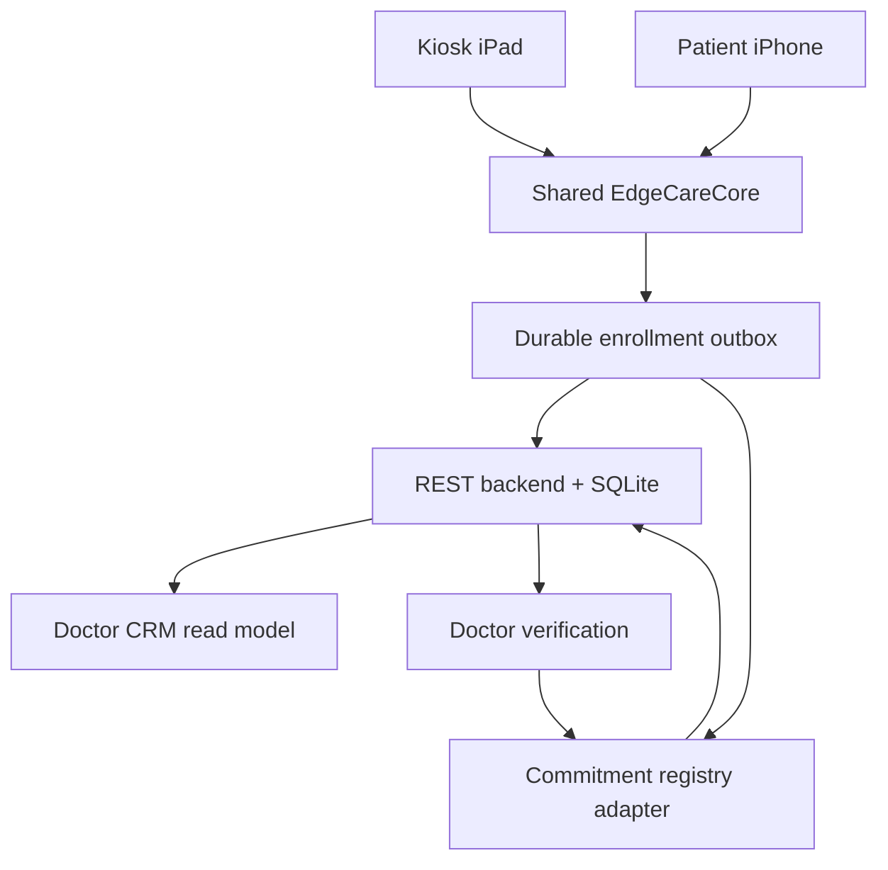

# Four systems, one protocol

| System | Entry point | Pattern | Shared boundary |
| --- | --- | --- | --- |
| 1. Kiosk iPad | `apps/kiosk-ios` | SwiftUI/MVVM, iPad only | EdgeCareCore + EdgeCareUI |
| 2. Doctor CRM | `apps/crm-web` | Next.js App Router + strict TS + Tailwind | shared-types + REST/SQLite |
| 3. Doctor verification | `apps/doctor-ios` | SwiftUI/MVVM, iPhone/iPad | EdgeCareCore verification/chain |
| 4. Patient phone | `apps/patient-ios` | SwiftUI/MVVM, intake + wallet shell | EdgeCareCore + EdgeCareUI |

The diagram describes the intended integration. Working scaffold components: CRM list/detail/filtering/polling, REST enrollment/read/verification routes, SQLite persistence and status reconciliation, shared wire fixtures, Swift crypto/DTW/verification/outbox foundations, and Anchor create/spend source. The native shells do not yet wire enrollment or verification controls to those services. The devnet adapter and registry watcher are placeholders.

Boundaries: no app-to-app calls; no patient accounts; no backend diagnosis; no network in native demo mode. On-device inference adapters are reserved, not shipped model weights. See the root API contract for encryption and settlement semantics.
