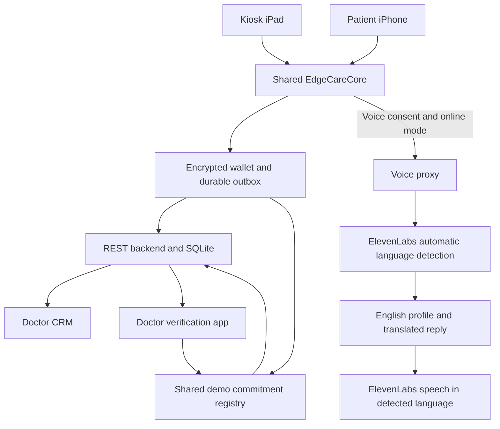

# Four systems, one protocol

| System | Entry point | Pattern | Shared boundary |
| --- | --- | --- | --- |
| Kiosk iPad | `apps/kiosk-ios` | SwiftUI/MVVM | EdgeCareCore + EdgeCareUI |
| Doctor CRM | `apps/crm-web` | Next.js App Router + strict TypeScript | shared-types + REST/SQLite |
| Doctor verification | `apps/doctor-ios` | SwiftUI/MVVM | EdgeCareCore verification/registry |
| Patient phone | `apps/patient-ios` | SwiftUI/MVVM | Shared intake + encrypted wallet |

`NativeSession` is the native composition boundary: enrollment, encrypted wallet, cached referrals, verification and queued reconciliation. AES-GCM encrypts wallet/outbox files using a random key stored in Keychain. Signature templates and private triage detail are additionally encrypted with the referral PIN-derived key. No PIN is persisted.

Local mode uses only local actors and makes no network calls. Connected-demo mode uses HTTP against the single local backend. An offline enrollment remains queued; doctor verification needs an already-cached envelope and commitment. Stable spend operation IDs make retrying a lost acknowledgement safe while rejecting a competing spend. The CRM polls the shared registry-derived read model.

Structured form answers produce canonical English clinical fields. Online voice turns use an explicitly consented proxy: audio recognition detects the language, the conversational adapter updates the English profile and asks a follow-up in the patient language, and ElevenLabs synthesizes that reply. The transient conversation and patient guidance remain distinct from the clinical profile. Switching to the form preserves a usable offline path.

Apple Vision performs OCR locally. The UI requires review before incorporating letter text and identifies lesion assessment as unavailable without a model. No medical image classifier is bundled. The deterministic triage adapter is labeled as scripted, non-diagnostic guidance.

The real Anchor program and signed devnet command-line adapter are separately executable; native connected-demo mode uses the persistent HTTP registry, not Solana. Production identity provisioning, hardened clinical storage, validated triage and a native signed devnet integration remain outside the demonstrated path.
